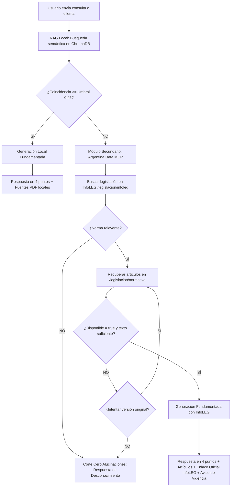

# ÁgoraIA — Chatbot RAG de Ética Periodística, Comunicación Digital e IA

**ÁgoraIA** es un asistente conversacional basado en arquitectura **RAG (Retrieval-Augmented Generation)** con **recuperación híbrida en dos niveles** para estudiantes, periodistas y académicos. Analiza dilemas éticos y jurídicos sobre periodismo, comunicación digital e Inteligencia Artificial generativa bajo una estricta regla de **Cero Alucinaciones** y **trazabilidad documental oficial**.

---

## 1. Stack Tecnológico

| Capa | Tecnología | Uso en el proyecto. |
| :--- | :--- | :--- |
| **Lenguaje backend** | Python 3.11 – 3.13 (recomendado) | Lógica RAG, orquestación y API REST. |
| **API Backend** | FastAPI + Uvicorn | Endpoints `/api/chat`, `/api/ingest`, `/api/sources`, `/api/health`. |
| **Orquestación IA** | LangChain (`langchain-core`, `langchain-community`, `langchain-text-splitters`) | Carga de documentos, fragmentación legal, prompts y cadena de generación. |
| **Carga de PDFs** | `PyPDFLoader` (con respaldo `pypdf`) | Extracción del texto de leyes e informes locales. |
| **Chunking legal** | `RecursiveCharacterTextSplitter` (`chunk_size=1000`, `overlap=200`) | Separadores por `ARTÍCULO`, `Art.`, `CAPÍTULO`, `Hallazgo`, etc. para no partir artículos legales. |
| **Embeddings** | `sentence-transformers/paraphrase-multilingual-MiniLM-L12-v2` (HuggingFace) u `text-embedding-3-small` (OpenAI) | Vectorización semántica multilingüe / español. |
| **Base vectorial local** | ChromaDB (similitud coseno) | Persistencia local en `backend/data/chroma_db` (1.303 fragmentos indexados). |
| **Respaldo vectorial** | `LocalCosineVectorStore` (TF-IDF + coseno, stdlib) | Activación automática de respaldo si ChromaDB no está disponible. |
| **Módulo secundario API** | **Argentina Data MCP** (REST API) | Consulta complementaria de legislación oficial en **InfoLEG** ante fallos del umbral local. |
| **LLM (opcional)** | GPT-4o-mini (OpenAI) o Gemini 2.5 Flash (Google) | Redacción de la respuesta estructurada de 4 puntos; funciona en **modo extractivo offline** sin API key. |
| **Validación** | Pydantic v2 / pydantic-settings | Validación de tipos, esquemas de API y carga segura de variables `.env`. |
| **Frontend** | Next.js 15 + React 19 + TypeScript | Interfaz conversacional responsiva. |
| **Estilos / UI** | Tailwind CSS 3 + Lucide React + react-markdown | Tarjetas de los 4 puntos analíticos, citas trazables de fuentes y badges de estado. |

---

## 2. Bases de Conocimiento

### 2.1 Base local prioritaria (`backend/data/pdfs/`)
El corpus documental local contiene 8 documentos normativos y deontológicos (369 páginas / 1.303 fragmentos):
1. **Constitución de la Nación Argentina** (Arts. 14, 19, 32, 43 — libertad de prensa, secreto de fuentes, hábeas data).
2. **Ley 26.522** de Servicios de Comunicación Audiovisual y Dec. 1225/2010 (pluralismo, niñez, derechos personalísimos).
3. **Ley 11.723** de Propiedad Intelectual (derechos de autor periodísticos, derecho de cita, retratos fotográficos).
4. **Ley 25.326** de Protección de los Datos Personales (datos sensibles, consentimiento, secreto de fuentes periodísticas).
5. **Ley 12.908** — Estatuto del Periodista Profesional (libertad de pensamiento y trabajo de prensa).
6. **Informe ADEPA 2026** — Inteligencia Artificial y Medios Argentinos (gobernanza, scraping, litigio Perfil vs. OpenAI/Microsoft).
7. **Guía ADEPA para el uso de la IA en medios** (los 8 principios rectores, *human-in-the-loop*, transparencia y atribución).
8. **Cuadro Resumen: Normas del ejercicio periodístico** (compendio de normas digitales, Leyes 26.032, 27.078, AAIP).

### 2.2 Base externa complementaria: Argentina Data MCP (InfoLEG)
Cuando una consulta jurídica del ámbito comunicacional o digital no alcanza el umbral de similitud en los PDFs locales, el sistema consulta en tiempo real el concentrador oficial de **InfoLEG** vía la API REST de **Argentina Data MCP**, recuperando artículos literales y enlaces oficiales del Estado argentino.

---

## 3. Arquitectura y Flujo de Recuperación

El sistema implementa una arquitectura en dos niveles gobernada por la regla de **Cero Alucinaciones**:



### Reglas clave del flujo:
1. **Prioridad absoluta del RAG local:** Si la base documental local supera el umbral, **nunca se invoca la API externa** (0 llamadas, ahorro de cuota).
2. **Segunda y última fuente:** Argentina Data MCP se consulta **exclusivamente como fallback** tras fallar el umbral local.
3. **Cero Alucinaciones:** Si ni la base local ni la API externa tienen contenido suficiente o relevante, el chatbot responde con el mensaje estricto de desconocimiento (`OUT_OF_DOMAIN_RESPONSE`), sin inventar leyes ni especular.

---

## 4. Nuevo Módulo: Argentina Data MCP (`backend/app/argentina_data.py`)

Este módulo fue diseñado para expandir la cobertura jurídica del chatbot de manera modular y segura, consumiendo la API de **Argentina Data MCP** ([Swagger Docs](https://argentinadata.mymcps.dev/api/docs)).

### 4.1 Endpoints consumidos

1. **`GET /legislacion/infoleg` (Búsqueda inicial):**
   * Busca normas (leyes o decretos) vinculadas a los términos clave de la consulta.
   * Extrae `id_norma`, `numero`, `tipo`, `titulo`, `norma_ref`, `estado_vigencia` y `url`.
   * **Filtro de relevancia:** Valida que el título pertenezca al ámbito de la comunicación, datos o tecnología, y descarta falsos positivos (por ejemplo, descarta normas de *"edulcorantes artificiales"* al buscar *"inteligencia artificial"*).

2. **`GET /legislacion/normativa` (Recuperación de artículos):**
   * Recupera los artículos solicitados (ej. `unidades="art 1,art 2"`).
   * **Estrategia de versiones:**
     * Intenta en primer lugar `version="actualizado"`.
     * Si `disponible: false`, intenta en segundo lugar `version="original"`.
   * **Aviso de vigencia:** Si se recupera texto original con modificaciones registradas, el sistema incluye explícitamente una advertencia en la respuesta indicando que es texto histórico y adjunta el enlace oficial para consultar reformas posteriores.

### 4.2 Control de consumo y tolerancia a fallos
* **Caché en memoria:** Evita consultas duplicadas durante la ejecución del backend.
* **Manejo controlado de códigos HTTP:**
  * `401` (No autenticado) y `402` (Cupo agotado): Se registran en logger y se conmuta limpiamente a respuesta de desconocimiento sin reintentos agresivos.
  * `429` (Rate limit) y `500` (Error de servidor): Se capturan con timeout de 6 segundos, evitando bloquear al usuario.
  * **Modo sin clave:** Si `ARGENTINA_DATA_API_KEY` no está configurada, el sistema continúa funcionando normalmente con el RAG local y corte de desconocimiento.

---

## 5. Estructura de las Respuestas de ÁgoraIA

Cada respuesta fundamentada generada por ÁgoraIA (sea local o vía InfoLEG) respeta obligatoriamente los **4 puntos metodológicos**:

1. **Identificación del Dilema:** Síntesis precisa de los principios éticos, deontológicos y jurídicos en tensión (ej. libertad de expresión vs. privacidad, transparencia algorítmica vs. propiedad intelectual).
2. **Marco Normativo / Base de Conocimiento:** Cita literal y trazable de las fuentes recuperadas (artículo, ley, página o enlace oficial de InfoLEG).
3. **Análisis de la Situación:** Ponderación crítica no binaria de las alternativas y consecuencias editoriales e institucionales.
4. **Conclusión o Recomendación:** Buenas prácticas deontológicas (*human-in-the-loop*, atribución explícita, verificación de fuentes y resguardo de la fe pública).

---

## 6. Estructura de Archivos del Repositorio

```text
AgoraIA/
├── README.md                           # Documentación general y arquitectura
├── docker-compose.yml                  # Despliegue en contenedores
├── backend/
│   ├── .env.example                    # Plantilla de variables de entorno
│   ├── .env                            # Configuración local activa (ignorado por Git)
│   ├── requirements.txt                # Dependencias Python
│   ├── ingest_cli.py                   # Script de indexación del corpus PDF
│   ├── test_argentina_data_acceptance.py # Suite de aceptación del módulo Argentina Data (8 pruebas)
│   ├── pyrightconfig.json
│   ├── data/
│   │   ├── pdfs/                       # Los 8 PDFs normativos locales
│   │   └── chroma_db/                  # Base vectorial persistida (ChromaDB)
│   ├── evaluation/
│   │   ├── eval_set.jsonl              # 31 casos de prueba automatizados
│   │   ├── run_eval.py                 # Ejecutor del benchmark
│   │   └── report.md                   # Reporte de métricas de precisión
│   └── app/
│       ├── main.py                     # API REST FastAPI y ciclo de vida
│       ├── config.py                   # Configuración tipada con Pydantic Settings
│       ├── argentina_data.py           # Cliente HTTP modular para Argentina Data MCP (InfoLEG)
│       ├── rag_pipeline.py             # Pipeline RAG híbrido y corte anti-alucinaciones
│       ├── ingestion.py                # Pipeline de lectura de PDFs, chunking y embeddings
│       ├── prompts.py                  # System Prompt institucional y plantillas
│       ├── schemas.py                  # Modelos Pydantic de entrada/salida
│       ├── cases.py                    # Catálogo de dilemas y casos emblemáticos
│       └── security.py                 # Detección de prompt injection y rate limiter
└── frontend/
    ├── package.json
    ├── tailwind.config.js
    ├── tsconfig.json
    └── src/
        ├── app/                        # Layout principal y página de chat (Next.js 15)
        ├── components/                 # Componentes UI (Chat, tarjetas de 4 puntos, fuentes, loader)
        ├── lib/api.ts                  # Cliente HTTP para comunicarse con FastAPI
        └── types/chat.ts               # Tipos TypeScript compartidos
```

---

## 7. Instrucciones para Ejecutar Localmente

### 7.1 Requisitos previos
* **Python 3.11 – 3.13** (`python --version`)
* **Node.js 20 o superior** con npm (`node --version`)

### 7.2 Configuración de variables (`backend/.env`)
Copia `.env.example` a `.env` (si aún no existe) y revisa los parámetros:

```env
# Proveedor de LLM (opcional: sin key funciona en modo extractivo local)
LLM_PROVIDER=openai
OPENAI_API_KEY=sk-tu-clave-aqui
# o con Gemini:
# LLM_PROVIDER=gemini
# GOOGLE_API_KEY=tu-clave-aqui

# Módulo secundario: Argentina Data MCP (InfoLEG)
ARGENTINA_DATA_API_KEY=tu-api-key-de-argentina-data
ARGENTINA_DATA_BASE_URL=https://argentinadata.mymcps.dev/api/v1
ARGENTINA_DATA_TIMEOUT_SECONDS=6.0

# Umbral Cero Alucinaciones y Base Vectorial
SIMILARITY_SCORE_THRESHOLD=0.45
TOP_K=5
```

### 7.3 Iniciar el Backend (Terminal 1)
En la carpeta raíz del proyecto (`AgoraIA`):

```powershell
cd backend
.\.venv\Scripts\Activate.ps1
uvicorn app.main:app --host 127.0.0.1 --port 8000
```
> *Si PowerShell restringe scripts de activación, ejecuta directamente:*
> `.\.venv\Scripts\python.exe -m uvicorn app.main:app --host 127.0.0.1 --port 8000`

* **API REST:** http://127.0.0.1:8000
* **Documentación interactiva Swagger:** http://127.0.0.1:8000/docs

### 7.4 Iniciar el Frontend (Terminal 2)
En una segunda terminal desde `AgoraIA`:

```powershell
cd frontend
npm run dev
```

* **Interfaz de usuario:** Abre http://localhost:3000 en tu navegador.

---

## 8. Verificación y Suites de Pruebas

### 8.1 Pruebas de aceptación del módulo Argentina Data MCP
Para verificar que el flujo de dos niveles y el módulo de legislación externa cumplen con todas las especificaciones:

```bash
cd backend
python test_argentina_data_acceptance.py
```

Valida automáticamente los 8 escenarios requeridos:
1. **RAG local alcanza el umbral:** 0 llamadas a la API externa.
2. **RAG local no alcanza el umbral y API encuentra norma (ej. Ley 26.032):** Respuesta fundamentada con artículos y URL oficial de InfoLEG.
3. **Resultados irrelevantes o falsos positivos (ej. edulcorantes):** Descarte y respuesta de desconocimiento.
4. **Respuesta `disponible: false`:** Reintento con versión original; si no hay texto, respuesta de desconocimiento.
5. **API Key no configurada:** Funcionamiento local normal y corte de desconocimiento sin fallos.
6. **Manejo de errores HTTP (401, 402, 429, 500, timeouts):** Control de excepciones y degradación limpia.
7. **Texto original con modificaciones registradas:** Aviso de vigencia explícito en la respuesta.
8. **Consultas fuera de dominio:** Conservación de la regla de Cero Alucinaciones.

### 8.2 Suite de evaluación global de ÁgoraIA (31 casos)
Para auditar la precisión en conceptos normativos, casos de estudio, dilemas éticos y resistencia a *prompt injection*:

```bash
cd backend
python evaluation/run_eval.py
```
El reporte detallado se guarda en `backend/evaluation/report.md`.

---

## 9. Endpoints de la API FastAPI

| Método | Ruta | Descripción |
| :--- | :--- | :--- |
| `GET` | `/api/health` | Estado del backend, chunks indexados en ChromaDB y proveedores activos. |
| `GET` | `/api/sources` | Catálogo de los 8 documentos PDF del corpus local y estado en disco. |
| `GET` | `/api/cases` | Catálogo de casos y dilemas éticos preconfigurados para exploración rápida. |
| `POST` | `/api/ingest` | Reindexación del corpus documental (`{"reset": true}` para recrear desde cero). |
| `POST` | `/api/chat` | Endpoint principal de consulta conversacional (RAG local + fallback Argentina Data MCP). |
| `POST` | `/api/feedback` | Registro de valoración (positivo/negativo) de respuestas para métricas de evaluación. |
