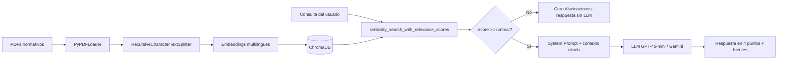

# ÁgoraIA — Chatbot RAG de Ética Periodística, Comunicación Digital e IA

**ÁgoraIA** es un asistente conversacional basado en arquitectura **RAG (Retrieval-Augmented Generation)** para estudiantes, periodistas y académicos. Consulta normativa argentina vigente y analiza dilemas éticos sobre periodismo e IA generativa con **trazabilidad documental** y regla de **Cero Alucinaciones**.

---

## 1. Stack Tecnológico

| Capa | Tecnología | Uso en el proyecto |
| :--- | :--- | :--- |
| **Lenguaje backend** | Python 3.11 – 3.13 (recomendado) | Lógica RAG y API. |
| **API** | FastAPI + Uvicorn | Endpoints `/api/chat`, `/api/ingest`, `/api/sources`, `/api/health`. |
| **Orquestación IA** | LangChain (`langchain-core`, `langchain-community`, `langchain-text-splitters`) | Carga de documentos, chunking, prompt y cadena de generación. |
| **Carga de PDFs** | `PyPDFLoader` (con respaldo `pypdf`) | Extracción del texto de leyes e informes. |
| **Chunking** | `RecursiveCharacterTextSplitter` (`chunk_size=1000`, `overlap=200`) | Separadores por `ARTÍCULO`, `Art.`, `CAPÍTULO`, `Hallazgo`, etc. para no partir artículos legales. |
| **Embeddings** | `sentence-transformers/paraphrase-multilingual-MiniLM-L12-v2` (HuggingFace) u `text-embedding-3-small` (OpenAI) | Vectorización multilingüe / español. |
| **Base vectorial** | ChromaDB (similitud coseno) | Persistencia local en `backend/data/chroma_db`. |
| **Respaldo vectorial** | `LocalCosineVectorStore` (TF-IDF + coseno, solo stdlib) | Se activa solo si ChromaDB no está instalado (p. ej. Python 3.14+). |
| **LLM** | GPT-4o-mini (OpenAI) o Gemini 2.5 Flash (Google) | Redacta la respuesta de 4 puntos con el System Prompt + contexto recuperado. |
| **Validación** | Pydantic v2 / pydantic-settings | Esquemas y configuración vía `.env`. |
| **Frontend** | Next.js 15 + React 19 + TypeScript | Interfaz conversacional. |
| **Estilos / UI** | Tailwind CSS 3 + Lucide React + react-markdown | Tarjetas de los 4 puntos, fuentes citadas y estados de carga. |
| **Contenedores (opcional)** | Docker Compose | Levantar backend y frontend juntos. |

### Base de conocimiento (`backend/data/pdfs/`)
- Constitución de la Nación Argentina
- Ley 26.522 (Servicios de Comunicación Audiovisual) y Dec. 1225/2010
- Ley 11.723 (Propiedad Intelectual)
- Ley 25.326 (Protección de Datos Personales)
- Ley 12.908 (Estatuto del Periodista Profesional)
- Informe ADEPA 2026 — IA y Medios Argentinos
- Guía ADEPA para el uso de la IA en medios argentinos
- Cuadro resumen de normas del ejercicio periodístico

---

## 2. Arquitectura



**Estructura de cada respuesta:** 1) Identificación del Dilema · 2) Marco Normativo / Base de Conocimiento · 3) Análisis de la Situación · 4) Conclusión o Recomendación.

---

## 3. Estructura del proyecto

```text
chatbot/
├── README.md
├── docker-compose.yml
├── backend/
│   ├── .env.example            # Plantilla de configuración
│   ├── requirements.txt
│   ├── ingest_cli.py           # Indexa los PDFs desde consola
│   ├── pyrightconfig.json
│   ├── data/
│   │   ├── pdfs/               # PDFs de la base de conocimiento
│   │   └── chroma_db/          # Índice vectorial (se genera solo)
│   └── app/
│       ├── main.py             # API FastAPI
│       ├── config.py           # Configuración y catálogo de documentos
│       ├── prompts.py          # System Prompt de ÁgoraIA
│       ├── schemas.py          # Modelos Pydantic
│       ├── ingestion.py        # PDFs → chunks → vectores
│       └── rag_pipeline.py     # Recuperación, umbral y generación
└── frontend/
    ├── package.json
    └── src/
        ├── app/                # layout y página principal
        ├── components/         # Chat, tarjetas de 4 puntos, fuentes, loader
        ├── lib/api.ts          # Cliente HTTP
        └── types/chat.ts
```

---

## 4. Ejecutar el proyecto en otra computadora

### 4.1 Requisitos previos

| Herramienta | Versión | Verificar con |
| :--- | :--- | :--- |
| Python | **3.11 – 3.13** (con 3.14+ funciona, pero sin ChromaDB: usa el índice de respaldo) | `python --version` |
| Node.js | 20 o superior (incluye npm) | `node --version` |
| Git (opcional) | cualquiera | `git --version` |
| API key (opcional) | OpenAI o Google AI Studio | — |

> Sin API key la app funciona igual en **modo extractivo**: recupera y cita los fragmentos normativos, pero no los redacta un LLM. Con una key real se activa la redacción generativa.

### 4.2 Obtener el proyecto
Copia la carpeta `chatbot/` completa (incluida `backend/data/pdfs/`) o clónala. **No copies** `backend/.venv`, `frontend/node_modules` ni `frontend/.next`: se regeneran en cada equipo.

### 4.3 Backend (terminal 1)

**Windows (PowerShell)**
```powershell
cd chatbot\backend
python -m venv .venv
.\.venv\Scripts\Activate.ps1
python -m pip install --upgrade pip
pip install -r requirements.txt
Copy-Item .env.example .env
```

**macOS / Linux**
```bash
cd chatbot/backend
python3 -m venv .venv
source .venv/bin/activate
python -m pip install --upgrade pip
pip install -r requirements.txt
cp .env.example .env
```

> Si PowerShell bloquea el script de activación, ejecuta `Set-ExecutionPolicy -Scope CurrentUser RemoteSigned` o usa directamente `.\.venv\Scripts\python.exe` en lugar de activar el entorno.

> **Python 3.14+:** `chromadb` y `sentence-transformers` aún pueden no tener paquetes precompilados. Instala solo lo esencial y la app usará el índice de respaldo:
> ```bash
> pip install fastapi "uvicorn[standard]" pydantic pydantic-settings python-dotenv pypdf langchain-core langchain-text-splitters langchain-community langchain-openai langchain-google-genai
> ```

**Configurar `backend/.env`** (opcional, para respuestas redactadas por LLM):

```env
# Con OpenAI
LLM_PROVIDER=openai
OPENAI_API_KEY=sk-tu-clave

# o con Gemini
LLM_PROVIDER=gemini
GOOGLE_API_KEY=tu-clave
```

Otros parámetros útiles: `SIMILARITY_SCORE_THRESHOLD` (0.45 por defecto), `TOP_K`, `CHUNK_SIZE`, `CHUNK_OVERLAP` y `EMBEDDING_PROVIDER` (`huggingface` u `openai`).

**Indexar los PDFs e iniciar la API**
```bash
python ingest_cli.py --reset
uvicorn app.main:app --host 127.0.0.1 --port 8000
```

La API queda en http://127.0.0.1:8000 (documentación Swagger en `/docs`). Si omites la indexación, el backend indexa los PDFs automáticamente al arrancar cuando el índice está vacío.

### 4.4 Frontend (terminal 2)

```bash
cd chatbot/frontend
npm install
npm run dev
```

Abre http://localhost:3000.

> En Windows, si `npm` falla por la política de ejecución de PowerShell, usa `npm.cmd install` y `npm.cmd run dev`.

Si el backend corre en otra dirección o puerto, define la variable antes de iniciar el frontend:
```bash
# macOS / Linux
NEXT_PUBLIC_API_URL=http://192.168.1.50:8000 npm run dev
# Windows PowerShell
$env:NEXT_PUBLIC_API_URL="http://192.168.1.50:8000"; npm run dev
```
Y agrega el origen del frontend a `CORS_ORIGINS` en `backend/.env`.

### 4.5 Con Docker (alternativa)
```bash
cd chatbot
cp backend/.env.example backend/.env
docker compose up
```
Frontend en http://localhost:3000 y backend en http://localhost:8000. Dentro del contenedor se usa Python 3.11, por lo que ChromaDB y HuggingFace sí quedan disponibles (la primera ejecución descarga el modelo de embeddings).

### 4.6 Verificación rápida
```bash
curl http://127.0.0.1:8000/api/health
```
Debe responder `"status": "ok"`, `"pdfs_available": 8` y un `indexed_chunks` mayor que 0.

### 4.7 Problemas frecuentes

| Síntoma | Solución |
| :--- | :--- |
| Encabezado muestra "Backend desconectado" | Verifica que `uvicorn` esté corriendo en el puerto 8000 y que `CORS_ORIGINS` incluya el origen del frontend. |
| `indexed_chunks: 0` | Ejecuta `python ingest_cli.py --reset` o el botón **Re-indexar Corpus** de la interfaz. |
| Todas las preguntas responden "no tengo información" | Baja el umbral con el control deslizante del encabezado o en `SIMILARITY_SCORE_THRESHOLD`. |
| `pip install` falla compilando `chromadb` / `onnxruntime` | Usa Python 3.11–3.13 o instala solo las dependencias esenciales (ver 4.3). |
| Puerto 8000 o 3000 ocupado | Cambia `--port` en `uvicorn` o ejecuta `npm run dev -- -p 3001` (y ajusta `CORS_ORIGINS`). |

---

## 5. Endpoints de la API

| Método | Ruta | Descripción |
| :--- | :--- | :--- |
| `GET` | `/api/health` | Estado del servicio, proveedor LLM/embeddings y chunks indexados. |
| `GET` | `/api/sources` | Documentos del corpus y si existen en disco. |
| `GET` | `/api/cases` | Catálogo de casos y situaciones dilemáticas del corpus. |
| `POST` | `/api/ingest` | Reindexa los PDFs (`{"reset": true}` reinicia el índice). |
| `POST` | `/api/chat` | Procesa una consulta o dilema con historial multi-turno, casos relacionados y corte anti-alucinación. |
| `POST` | `/api/feedback` | Registra la valoración (`up` / `down`) de una respuesta para evaluación. |

---

## 6. Evaluación Automática

Para ejecutar la suite de 31 pruebas automatizadas (conceptos, casos, dilemas, seguimiento multi-turno, preguntas fuera de dominio y bloqueo de *prompt injection*):

```bash
cd backend
python evaluation/run_eval.py
```

El reporte cuantitativo se guarda en `backend/evaluation/report.md`.

---

## 7. Reglas de comportamiento implementadas

1. **Trazabilidad:** cada respuesta cita documento, página y artículo recuperados.
2. **Cero Alucinaciones:** si ningún fragmento supera el umbral de similitud, el backend corta antes de llamar al LLM y responde que no tiene información.
3. **Análisis crítico:** el System Prompt exige identificar valores en conflicto, sin respuestas binarias.
4. **Tono:** profesional, educativo, neutral y reflexivo.
